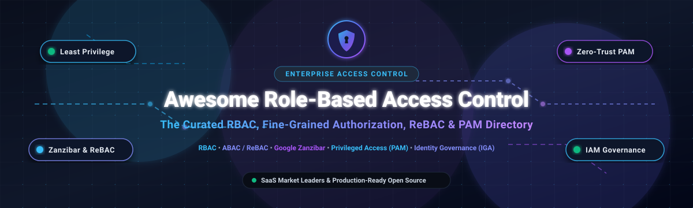

# Awesome Role-Based Access Control (RBAC) [](https://awesome.re)

<p align="center">
  
</p>

<p align="center">
  <strong>A curated directory of premier Role-Based Access Control (RBAC), Fine-Grained Authorization (FGA/ReBAC/ABAC), Identity Governance & Administration (IGA), and Privileged Access Management (PAM) tools.</strong>
</p>

<p align="center">
  <a href="#sector-overview--market-dynamics">Sector Overview</a> •
  <a href="#saashosted-platforms">SaaS Platforms</a> •
  <a href="#open-source-github-projects">Open-Source Projects</a> •
  <a href="#architectural-patterns--evaluation">Architecture Guide</a> •
  <a href="#how-to-contribute">Contribute</a>
</p>

---

## Sector Overview & Market Dynamics

The global Identity and Access Management (IAM) and Access Control market is estimated at **$18.5 Billion to $22.3 Billion in 2026** (projected to exceed $41 Billion by 2031, growing at a CAGR of ~13.5%). The sector exhibits **moderate fragmentation with multi-segment concentration**: monolithic enterprise identity consolidation is heavily concentrated among mega-cap providers like Microsoft and Okta, while specialized fine-grained authorization (FGA/Zanzibar-style ReBAC), non-human/AI agent access control, and privileged access management (PAM) remain vigorously competitive and fragmented with thriving open-source standards.

---

## SaaS/Hosted Platforms

The table below outlines leading commercial SaaS platforms providing workforce and customer RBAC, fine-grained access policies, and privileged credential governance, sorted in descending order of market scale (market capitalization / valuation / annual revenue).

| Product | Enterprise Scale / Valuation / Revenue | Starting Pricing Tier | Free Tier & Free Trial Limits | Key Access Control Focus |
| :--- | :--- | :--- | :--- | :--- |
| **[Microsoft Entra ID](https://www.microsoft.com/en-us/security/business/microsoft-entra)** | **~$3.1 Trillion** (Market Cap; ~$3.5B+ Entra/IAM ARR) | **$3.00/user/month** (Entra ID P1) | Free forever plan included with Microsoft Cloud accounts (up to 50,000 objects, core RBAC, self-service password reset); 30-day trial for P1/P2 | Enterprise cloud directory, Azure & M365 RBAC, Conditional Access, and Privileged Identity Management (PIM). |
| **[Shopify Staff Accounts](https://help.shopify.com/en/manual/your-account/staff-accounts)** | **~$140 Billion** (Market Cap; ~$8.9B Rev) | **$39/month** (Basic plan includes 2 staff accounts) | 3-day free trial with full store administration access (no credit card required), followed by $1/mo promo for the first month | Native multi-user e-commerce admin RBAC, order/product permissions, and collaborator account isolation. |
| **[CyberArk](https://www.cyberark.com/)** | **~$18 Billion** (Market Cap; ~$1.0B ARR) | **$5.00/user/month** (CyberArk Workforce Identity starting package) | 30-day full-featured free trial of CyberArk Privileged Access Manager or Workforce Identity (up to 100 managed identities) | Industry-leading Privileged Access Management (PAM), credential vaulting, session recording, and endpoint least privilege. |
| **[Rippling Identity](https://www.rippling.com/)** | **~$13.5 Billion** (Private Valuation; ~$500M+ ARR) | **$8.00/employee/month** (Core platform base) | No free forever tier; 14-day interactive guided demo sandbox with sample organizational role charts | Unified HRIS-driven RBAC, automated role provisioning/deprovisioning across 500+ apps, and device identity enforcement. |
| **[Okta](https://www.okta.com/)** | **~$13 Billion** (Market Cap; ~$2.6B ARR) | **$2.00/user/month** (Single Sign-On basic tier; minimum contract applies) | 30-day free trial of Workforce Identity Cloud (full enterprise feature access, up to 100 users, directory integration) | Universal Directory, fine-grained role-based access policies, lifecycle management, and adaptive authentication. |
| **[SailPoint](https://www.sailpoint.com/)** | **~$6.9 Billion** (Acquired by Thoma Bravo; ~$650M+ ARR) | **$5.00/user/month** (Identity Security Cloud Essentials tier estimate) | No free forever plan; 30-day assisted proof-of-concept (PoC) sandbox trial for enterprise evaluation | Enterprise Identity Governance and Administration (IGA), automated role mining, access certification, and compliance auditing. |
| **[Ping Identity](https://www.pingidentity.com/)** | **~$2.8 Billion** (Acquired by Thoma Bravo; ~$400M+ ARR) | **$3.00/user/month** (PingOne for Workforce basic package) | 30-day free trial of PingOne Cloud Platform (unlimited users, SAML/OIDC SSO, and role orchestration during trial) | Hybrid workforce & customer identity, adaptive MFA, directory services, and centralized API authorization policies. |
| **[JumpCloud](https://jumpcloud.com/)** | **~$2.6 Billion** (Valuation; ~$150M+ ARR) | **$9.00/user/month** (Core Directory package) | **Free forever plan: up to 10 users and 10 devices** with full directory, SSO, RADIUS, and RBAC features; includes 10 days of premium chat support | Cloud-native directory platform uniting cross-OS device management (macOS, Windows, Linux) with unified RBAC and SSO. |
| **[BeyondTrust](https://www.beyondtrust.com/)** | **~$1.7 Billion** (Private Equity Backed; ~$350M+ ARR) | **$26.00/user/month** (Password Safe / Endpoint Privilege Management starting tier) | 14-day free trial of Endpoint Privilege Management and Remote Support with complete admin console access | Privileged credential governance, zero-trust endpoint least-privilege delegation, and remote access monitoring. |
| **[OneLogin](https://www.onelogin.com/)** | **~$800 Million** (Acquired by One Identity / Quest Software; ~$150M ARR) | **$4.00/user/month** (Advanced Directory & SSO tier) | 30-day free trial with full access to SmartFactor Authentication, SSO catalog, and user provisioning connectors | Cloud identity management, automated SCIM provisioning, role-based application entitlement mapping, and MFA. |

---

## Open-Source GitHub Projects

The following curated open-source projects power modern access control architectures—spanning full IAM suites, policy-as-code engines, Google Zanzibar-inspired relationship-based access control (ReBAC), and privileged access platforms. Ranked in descending order of GitHub community stars.

| Repository | GitHub Stars | Architecture Layer & Model | License | Primary Capabilities |
| :--- | :---: | :--- | :--- | :--- |
| **[Keycloak](https://github.com/keycloak/keycloak)** | [](https://github.com/keycloak/keycloak/stargazers) | Full IAM Platform (RBAC, OIDC, SAML) | Apache-2.0 | Standard self-hosted enterprise IAM; centralized user federation, fine-grained role assignments, social login, and realm-based multi-tenancy. |
| **[JumpServer](https://github.com/jumpserver/jumpserver)** | [](https://github.com/jumpserver/jumpserver/stargazers) | Privileged Access Management (PAM) | GPL-3.0 | The open-source standard for PAM; browser-based bastion host securing SSH, RDP, Kubernetes clusters, and databases with role-based session recording. |
| **[Authelia](https://github.com/authelia/authelia)** | [](https://github.com/authelia/authelia/stargazers) | Lightweight SSO & Reverse-Proxy RBAC | Apache-2.0 | Companion authentication portal for reverse proxies (Nginx, Traefik, Caddy, Envoy) with 2FA, Duo, WebAuthn, and domain-level role rule definitions. |
| **[Casbin](https://github.com/casbin/casbin)** | [](https://github.com/casbin/casbin/stargazers) | Authorization Library (RBAC / ABAC / ACL) | Apache-2.0 | Multi-language access control library supporting PERM metamodel; natively enables RBAC with role hierarchy, resource-level RBAC, and ABAC across Go, Java, Python, Node, and C++. |
| **[ZITADEL](https://github.com/zitadel/zitadel)** | [](https://github.com/zitadel/zitadel/stargazers) | Cloud-Native IAM (RBAC & Multi-Tenancy) | Apache-2.0 | Built with event sourcing for immutable audit logging; provides turnkey multi-tenancy, passkeys/FIDO2, role assignment grants, and OIDC federation. |
| **[Logto](https://github.com/logto-io/logto)** | [](https://github.com/logto-io/logto/stargazers) | Developer Auth & RBAC Infrastructure | Mozilla-2.0 | Modern developer-first identity platform with out-of-the-box API resource scopes, role-based permissions, multi-tenant organization workspaces, and webhooks. |
| **[Casdoor](https://github.com/casdoor/casdoor)** | [](https://github.com/casdoor/casdoor/stargazers) | UI-First IAM & MCP Agent Gateway | Apache-2.0 | Turnkey authentication server with web UI; includes Casbin-powered RBAC, OAuth 2.0/SAML/LDAP connectors, and emerging support for AI agent / Model Context Protocol (MCP) authentication. |
| **[Ory Kratos](https://github.com/ory/kratos)** | [](https://github.com/ory/kratos/stargazers) | Headless Identity & User Management | Apache-2.0 | API-first, cloud-native identity management service; decouples identity profiles and authentication flows from UI, designed to pair with fine-grained authorization layers. |
| **[Open Policy Agent (OPA)](https://github.com/open-policy-agent/opa)** | [](https://github.com/open-policy-agent/opa/stargazers) | General-Purpose Policy Engine (Rego) | Apache-2.0 | CNCF Graduated policy-as-code engine; decouples authorization decisions across microservices, Kubernetes admission control, CI/CD pipelines, and application RBAC. |
| **[SpiceDB](https://github.com/authzed/spicedb)** | [](https://github.com/authzed/spicedb/stargazers) | Zanzibar ReBAC Permissions Database | Apache-2.0 | Production-grade open-source implementation of Google's Zanzibar paper; stores relationship tuples, resolves recursive graph authorization checks in sub-milliseconds with cross-region consistency. |
| **[Permify](https://github.com/Permify/permify)** | [](https://github.com/Permify/permify/stargazers) | Fine-Grained Authorization (Zanzibar DSL) | Apache-2.0 | Zanzibar-inspired authorization engine with intuitive policy schema DSL; unifies hierarchical RBAC, relationship-based access control, and contextual ABAC attributes. |
| **[Ory Keto](https://github.com/ory/keto)** | [](https://github.com/ory/keto/stargazers) | Zanzibar Access Control Server | Apache-2.0 | Ultra-fast access control server written in Go based on Google Zanzibar; exposes gRPC and REST APIs for checking permissions, evaluating relation tuples, and managing access rules. |
| **[Cerbos](https://github.com/cerbos/cerbos)** | [](https://github.com/cerbos/cerbos/stargazers) | Context-Aware Policy-as-Code Engine | Apache-2.0 | Stateless authorization sidecar evaluating YAML-based policies; seamlessly combines role definitions with resource state and contextual request attributes (ABAC + RBAC). |
| **[Apache Ranger](https://github.com/apache/ranger)** | [](https://github.com/apache/ranger/stargazers) | Enterprise Data Lake Access Governance | Apache-2.0 | Comprehensive security framework to manage data security policies across Hadoop, Spark, Trino, Hive, and Kafka with centralized role administration and deep auditing. |
| **[Athenz](https://github.com/AthenZ/athenz)** | [](https://github.com/AthenZ/athenz/stargazers) | Dynamic Infrastructure & X.509 RBAC | Apache-2.0 | Yahoo-developed platform providing X.509 certificate identity and decentralized role-based authorization tokens for dynamic workloads, microservices, and Kubernetes. |
| **[WSO2 Identity Server](https://github.com/wso2/product-is)** | [](https://github.com/wso2/product-is/stargazers) | Enterprise Digital Public Good IAM | Apache-2.0 | Battle-tested enterprise IAM platform managing millions of identities; provides SCIM 2.0 user provisioning, adaptive MFA, XACML authorization, and deep RBAC support. |
| **[midPoint](https://github.com/Evolveum/midpoint)** | [](https://github.com/Evolveum/midpoint/stargazers) | Identity Governance & Administration (IGA) | Apache-2.0 | The open-source gold standard for comprehensive IGA; delivers identity synchronization, role mining, segregation of duties (SoD), and compliance recertification. |

---

## Architectural Patterns & Evaluation

Modern access control systems rarely rely on a single paradigm. Organizations scale their authorization stacks using three core tiers:

```
┌────────────────────────────────────────────────────────┐
│             Identity Layer (IAM / SSO / OIDC)          │
│    Keycloak • Okta • Entra ID • ZITADEL • Authelia     │
└───────────────────────────┬────────────────────────────┘
                            │ Who is the user?
┌───────────────────────────▼────────────────────────────┐
│         Fine-Grained Authorization (FGA / ReBAC)       │
│      Permify • SpiceDB • Casbin • Cerbos • OPA         │
└───────────────────────────┬────────────────────────────┘
                            │ Can User X perform Action Y on Resource Z?
┌───────────────────────────▼────────────────────────────┐
│      Governance & Privileged Access (IGA & PAM)        │
│        JumpServer • midPoint • CyberArk • SailPoint    │
└────────────────────────────────────────────────────────┘
```

1. **Role-Based Access Control (RBAC)**: Best for coarse-grained administrative entitlements (e.g., `admin`, `editor`, `billing-manager`). Simple to model and audit, but can suffer from "role explosion" when conditional nuances arise.
2. **Relationship-Based Access Control (ReBAC)**: Patterned after Google Zanzibar. Ideal for nested hierarchies (e.g., `"user is member of team, team owns folder, folder contains document"`). Powered by engines like **SpiceDB** and **Permify**.
3. **Attribute-Based Access Control (ABAC) & Policy-as-Code**: Dynamic, context-aware rule evaluation based on environment attributes (time of day, location, resource status, IP). Championed by **Open Policy Agent (OPA)** and **Cerbos**.
4. **Privileged Access Management (PAM)**: Protects high-risk infrastructure credentials (SSH keys, cloud root logins, database superusers) through ephemeral leases and session monitoring via **JumpServer** or **CyberArk**.
5. **Identity Governance & Administration (IGA)**: Manages the lifecycle of identity entitlements, automated role mining, and regulatory audits (NIS2, SOC 2, HIPAA, GDPR) via platforms like **midPoint** or **SailPoint**.

---

## How to Contribute

We welcome contributions from security engineers, identity architects, and developers!

1. **Fork the repository** to your GitHub account.
2. **Edit `README.md`** ensuring you follow the table formatting:
   - Provide direct URLs and accurate GitHub links.
   - For SaaS additions, provide concrete pricing and free trial / free tier terms.
   - For open-source additions, ensure the shields.io badge uses `style=social&color=white` and links to the stargazers page.
3. **Verify alphabetical or metric-based sorting** within the respective tables.
4. **Submit a Pull Request** with a concise summary of the addition.

---

## Disclaimer & Compliance

- This list is a community-curated resource for informational and architectural evaluation purposes.
- Access control mechanisms directly impact cybersecurity perimeter integrity. Always perform rigorous threat modeling, penetration testing, and code audits before deploying identity services to production environments.
- Verify license compliance for self-hosted solutions in commercial environments (e.g., Apache-2.0, AGPL-3.0, GPL-3.0).

---

<p align="center">
  <sub>Maintained for security engineers, zero-trust architects, and IAM professionals worldwide.</sub>
</p>
